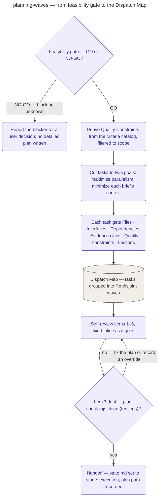

# Planning Waves

The pipeline's Planning stage: turns an approved spec into an implementation plan that doubles
as the execution strategy, ending in either a wave plan or a NO-GO report.

Before any task is written, a feasibility pass verifies every API, module, tool, doc section,
and convention the spec names against the real repo — never assumed — and spikes the riskiest
unknown if a quick spike can settle it. It starts from `scripts/spec-claims.mjs check`, which
reports the spec reviewer's confirmed claims whose cited files are unchanged since review, and
re-verifies only the rest. That pass ends in an explicit **GO** or **NO-GO**
verdict: a NO-GO names each blocking unknown in plain language and stops for a user decision
rather than burying the risk inside a detailed plan. Only past GO does planning read the quality
criteria catalog, filtered to the confirmed scope, and emit one `QC<n>` line per applicable
constraint — kept in its own `## Quality Constraints` section, never merged with the spec's
verbatim `## Global Constraints`, so the precedence between "the spec said so" and "the criteria
catalog derived this" stays visible.

Task boundaries are then drawn to two goals held together, not traded off: maximize parallelism
(file-disjoint, dependency-free tracks) and minimize each implementer's context (every brief
self-contained, with exact interfaces pinned so concurrent implementers never need each other's
history). Every task is drafted per `references/plan-task-format.md` under every engine: it owns the
template (`Files`, `Interfaces`, the `Quality constraints` line and the three per-task declaration
lines: `Dependencies` derived from what's actually consumed, `Evidence` in one of the three classes
evidence.md owns, and an optional `Execution: sweep` marker for one uniform edit rule), No
placeholders and the per-task checks. At `lean`/`standard` the playbook's Plan Mechanics section
supplies the plan header and the self-review; at `thorough` the `superpowers:writing-plans`
sub-skill supplies those mechanics instead, with rules this playbook
always keeps regardless: the executor named in the plan header is always `executing-waves.md`,
the header names the repo's whole verification gate as one `**Verification gate:**` command — the
single command every test-class task's evidence captures and the green gate re-runs — no task
ever carries a commit step, and the plan gate below runs on the finished plan.

Three rules hold under both engines. A planner derives each task's `Files` block by running
`scripts/blast-radius-check.mjs --scan` on the files the task modifies: an advisory pass over every
text code file, not only JS/TS/Python, that matches the symbols each file declares (plus any
`--symbol` given) and its basename with or without the extension, and tags each referencer `test`,
`subclass` or `consumer`, and prints which extensions it read and which files are not on disk. A `red-green` task
pins its interfaces, its complete failing test code and its gate commands verbatim and describes its
implementation in prose: a plan is contract-only by default, and `**Detail:** code-pinned — <reason>`
opts one task into a full implementation body. And a large plan is delegated: 3+ independent feasibility
unknowns run as parallel spikes, each a fast-tier `Explore` dispatch returning at most fifteen lines
(an unknown that needs only reading rides the research dispatch instead), and the drafting strategy comes
from a decision table the coordinator runs once the task cut exists (`scripts/plan-strategy.mjs`): a cut
of up to `12` tasks, or of little weight, drafts inline; a larger, coupled or narrow one drafts
`checkpointed`, inline in one segment per wave group; a wide, loosely coupled one drafts `grouped`, in
rounds of `devcycle:plan-drafter` dispatches that each hold up to three tasks of one wave, never more
than four at once; above `25` tasks planning suggests splitting the spec. Drafters read a context pack,
`.devcycle/plan-work/<run id>/pack.md` (about 8k tokens, stable content first), and
`references/plan-task-format.md` instead of this playbook, and each writes its task to a work file, `.devcycle/plan-work/<run id>/tasks/task-<n>.md`, after running the
`--draft` gate on it. On every path the work files are the canonical copy: `scripts/plan-assemble.mjs`
assembles the plan from them without the coordinator reading a draft, and a later fix goes into the task
file and is re-assembled. Under `grouped`, after each round `scripts/interface-lock.mjs` copies the
round's `Produces` items into `interfaces.lock.md`; later rounds' drafters reproduce what they consume
verbatim, the script checks it, and a drafter that must change a locked interface returns an
`interface-delta` for the coordinator to accept or refuse. Across tasks, the plan gate's `crossTask` leg
scans for placeholders and back-references, and one fast-tier checker dispatch per batch of up to eight
producer-to-consumer pairs writes its findings to a file, returning the path and a count. A finding goes back to its task's
drafter as a patch rather than a redraft, and after one checker round and one repair round, whatever is
still open goes to the user, per
[`references/delegated-planning.md`](../../../references/delegated-planning.md). Every planning
dispatch names its model, at the tier
[`references/model-routing.md`](../../../references/model-routing.md) § Planning dispatches assigns,
and doctor's Planning breakdown reports it: `drafters:` lists each drafter's turns and model,
`source prints:` counts Bash calls that printed a source file, and `tier-fit:` flags a spike,
research or checker dispatch that ran outside the fast tier. Whichever
strategy ran, the finished plan looks the same.

Once the plan is drafted, planning runs a seven-item self-review — spec coverage, the per-task
checks `references/plan-task-format.md` owns (placeholder scan, factual-claim accuracy, assumed-tooling
and pinned-code cross-check, and the per-draft gate), type consistency, no count-only enumeration,
mirrored-file parity, proportion, and the plan gate last — fixing what it finds
inline, with no separate re-review pass. The plan gate is one command,
`scripts/plan-check.mjs`, running ten legs over the plan: `codeBlocks` (pasted JS/mjs code
blocks parse), `briefCompleteness` (every task carries its required fields, a `red-green` task
that creates a non-test source file mentions a stub and pins its failing test in a fenced block, a
`**Detail:**` line gives a reason, and the Dispatch Map lists every task; it also notes, without
failing, each prescribed git command the dispatch guard would deny an implementer), `blastRadius` (every JS/TS/Python file naming a changed file's basename (a changed non-code file's `<parent>/<basename>`), test or
not, sits in some Files block; each finding opens with the task that declares the changed file), `contentCoupling` (no same-wave task's brief names a file another same-wave task
edits), `budgetFixtures` (a task touching a budgeted surface — `playbooks/`, `commands/`,
`agents/`, `references/` markdown — also touches its budget fixtures and
`docs/decisions/README.md`, whose `budget:` lines `validate.mjs` holds the fixtures to),
`waveDisjointness` (no two same-wave tasks list the same file), `authoredClaims` (the
factual-claim item's backstop: an unguarded `path.ext:line` reference or bare count claim,
cleared by a `(verified: <cmd>)` or `(assumption)` marker), `briefFacts` (every path a brief
cites resolves and every cited line is within its file; it also notes a call-shaped span nothing
defines), `proportion` (the plan stays near its spec's size and mostly prose rather than code: a note
above the warn figures, a failure above the higher ones unless a reason is recorded) and `crossTask`
(what one task consumes from another is something that task pins, and no brief defers its content to a
placeholder or a "similar to Task N" back-reference). `--draft` runs five of the legs on one drafted
task file. `node scripts/plan-check.mjs --help` prints the same legs and override forms. It fails closed: a plan with no
`## Dispatch Map` is a finding before any leg runs. Five findings clear by an explicit override
line instead of a fix — `- Blast-radius override:`, `- Content-coupling override:`,
`- Budget-fixture override:`, `- Citation override:` and `- Proportion override:`, each with a reason. A non-zero exit is a hard stop, resolved by
fixing the plan or recording an override, never by handing off around it. On success the gate
prints one ok line, with each leg's notes (such as cleared overrides) reduced to a count unless
`--verbose` lists them; a failing run always lists them. A run in progress records a `gate-ran`
event with its result.

The plan's required final section, the `## Dispatch Map`, groups every task into waves — a wave
holds only dependency-ready, file-disjoint tasks, never two tasks that touch the same file even
if both declare no dependency. That map is what `executing-waves.md` dispatches from. Planning
closes by writing `.devcycle/state.md` (`stage: execution`, the plan path) and emitting the
stage's handoff block; committing the saved plan itself is gated on the repo's doc-tracking
policy and whether the plan's path is git-ignored.

## How it fits
- Up: [the pipeline](../../pipeline/README.md) — where Planning sits, between Brainstorm and
  Execution.
- Source: [`playbooks/planning-waves.md`](../../../playbooks/planning-waves.md) — the behavior
  spec this page summarizes.

Playbook-internal — for where Planning sits in the pipeline, see
[docs/pipeline/](../../pipeline/README.md).

## Projected cost, the budget and resume

At the task cut, planning prints the projected cost of the strategy the decision table chose,
before any drafter runs: dispatches, tokens and dollars, by role. The projection comes from
[`scripts/plan-cost.mjs`](../../../scripts/plan-cost.mjs) and is recorded as `est` on the
`drafting-plan` row of the stage log, beside `spent`, the planning dollars so far
(`plan-stats.mjs spent --state <state.md>` prints it). `plan-strategy.mjs --sessionModel <id>` prices
the session on the model the run uses.

The `planningBudgetUSD` knob ([`docs/configuration/README.md`](../../configuration/README.md))
sets a dollar ceiling, and its default of `0` sets none. When the projection exceeds the ceiling,
planning asks one question with three answers: **proceed**, **switch strategy** or **reduce
scope**. While the estimate is uncalibrated, the question labels the figure as such. Whether it is
calibrated is decided by the passes recorded in [`scripts/plan-cost.mjs`](../../../scripts/plan-cost.mjs)
(`CALIBRATION`, `isCalibrated`), which the benchmark follow-up updates.

A depth probe runs after each `plan-group-<k>` under `checkpointed`, or once under `inline`. At
`over-budget` or `hard-stop`, planning logs `plan-checkpoint-<k>`, marks the state file `handoff: ready`
and emits a mid-stage handoff, `Session ended mid-planning: group <k> of <m>`, whose context action is
clear and continue. Nothing asks the user to accept a checkpoint. The next session resumes from disk:
[`references/resume.md`](../../../references/resume.md) § Resuming at the recorded stage reads the
planning position that `scripts/plan-resume.mjs` prints, and the drafters read the context pack that
[`references/delegated-planning.md`](../../../references/delegated-planning.md) § The context pack owns.

At handoff, [`scripts/plan-stats.mjs`](../../../scripts/plan-stats.mjs) prints the planning line, whose
format [`references/handoff.md`](../../../references/handoff.md) owns, and records `estUsd` (the
whole-stage estimate, `est` plus `spent`) and `coordinatorDepthPct` on its row. Doctor's Planning breakdown then prints the projection error for the
run as a `projection:` line, and the P5 row, coordinator depth at handoff, whose bar is `<= 15%`.

## Benchmarking planning strategies

`planningStrategy` forces how planning drafts: `status-quo` keeps the old thresholds, `inline` drafts
every task in the planning session, `checkpointed` drafts inline in segments, `grouped` drafts in rounds
of grouped drafters, `grouped-fork` is `grouped` with forked drafters (experimental), and `auto` runs the
decision table. A pass runs `status-quo` and `inline` by default; `--arms` adds the other three. The replay benchmark (#449) runs the same specs
through each arm and scores each run against the P1–P12 planning rubric doctor prints, so a
planning change is measured before it ships. Everything it reads and writes stays under the
gitignored `.devcycle/plan-bench/`:

- `manifest.json` — `{"entries": [{id, size, repoPath, baseSha, specPath, tasks?, execute?}]}`.
  `size` is `small`, `medium` or `large`. `tasks`, the planned task count the estimate prices, defaults
  by size, and `execute` defaults to true for `medium`, whose plans are also executed so P2 and P10 are
  measured. `node scripts/plan-bench-corpus.mjs` proposes one from this repo's archived cycles as
  `manifest.proposed.json`; rename it once you have checked it.
- `answers/<id>.json` — `{"prompt"?, "answers": [{match, reply}]}`. A headless session cannot ask,
  so a gate ends the session with its question as text; the first unused answer whose `match` (a
  case-insensitive regular expression) finds the question is sent back on the same session, and
  each listed answer is used once. Without a file, one standing answer matches every gate, so it
  confirms triage and takes the recommended option at every later gate too.
- `passes/<pass>/<id>--<arm>/` — each replay's legs, state file, run record, transcripts and
  `outcome.json`, and per pass `results.md`, the P1–P12 table.

`node scripts/plan-bench.mjs estimate` prints what a pass would cost and a go-ahead token. Both
`estimate` and `run` first refuse (exit 2, naming the entry) a pass whose repo, `baseSha` or spec
is missing, or whose pass id already holds a run, so a pass is never started that would die after
spending: pick a new `--pass` to rerun.
`run --go-ahead <token>` spends money, so it runs only with the token of an estimate the user
approved: it refuses past `--budget` (default $150) and stops spending once the budget is gone. The
estimate takes the upper ends of #442's per-task rates, so one `small`, one `medium` and one `large`
entry at their default sizes estimates $182.40 and is refused at the default budget; the refusal names
the two ways forward, a smaller corpus (fewer `--entries`, a smaller `size` or `tasks`) or an explicit
`--budget` above the estimate, which is the user's decision, not the harness's. `run` also refuses to
start in a driven (unattended) session, where `DEVCYCLE_DRIVE_TOKEN` is set (`estimate` stays allowed),
and refuses when the installed plugin list cannot be read, since the arm could then not be forced.
`PLAN_BENCH_STUB_ONLY=1` makes `run` refuse the real `claude` and demand `--claude <stub>`; the tests set
it, so no test can launch a paid pass however it is started. `--leg-timeout <seconds>` (default 7200)
kills a leg that outlives it and records its replay as an `error`. A leg that never reports its cost, one
killed at that timeout or one that ends with no result event, is charged the spend cap it ran under, which is the
budget still unspent, so a pass that loses a leg stops there and its total stays within `--budget`. Each replay plans in a scratch clone
on `dev` at `baseSha`, so execution cuts its own topic branch as in a real repo, with no remote to push to, loaded with `--plugin-dir` on the checkout under test, so
nothing it does touches the source repo, and its leg environment drops the driver variables
(`DEVCYCLE_DRIVE_TOKEN` and the nested-run ones). A replay that cannot start is recorded as an `error`
outcome and the pass carries on. A replay is capped at 8 legs when it only plans and 14 when it also
executes, and an executing replay whose last two execute legs moved neither the state file nor the
ledger ends `stalled`. A plan leg that ends at a mid-planning checkpoint (a ready planning handoff with no plan, after the leg logged a `plan-checkpoint-<k>` key) is followed by a fresh `/devcycle:continue` leg, not scored a NO-GO, and only a plan-only replay is prompted to stop at the planning handoff: the cycle records the prompt as its `request:`, and an executing replay's later legs would honour that stop. A leg a usage limit stopped (a rejected `rate_limit_event`, read by [`scripts/usage-limit.mjs`](../../../scripts/usage-limit.mjs)) is waited out to its reset plus a minute and its session resumed, and it does not count toward the leg cap; a limit with no reset, one more than 6 hours off, or a fourth in one replay ends the replay `rate-limited`. Each replay directory also keeps its run's `stage-log.jsonl`. `score --pass <pass>` re-scores a finished pass for free, counting only the replays the pass started, and
flags in the Outcome column a replay whose state file's `knobs:` line resolved a `planningStrategy` other
than its arm (`arm-mismatch`) or none (`arm-unverified`; the run record does not carry that knob), and
`node scripts/cost-model-fit.mjs --runs <runs dir>` fits the cost model's per-role F, t, r and o from
the `agent-cost` rows a pass collected. [`docs/platform-notes.md`](../../platform-notes.md) § (r)
records how a headless session is driven through its gates.

[`scripts/plan-cost.mjs`](../../../scripts/plan-cost.mjs) owns every figure a pass prices with, but the
two readers use different ones: `estimate` reads the per-task rates (`PLANNING_RATES` and
`EXECUTION_RATE`, which `scripts/plan-bench.mjs` imports) and the projection at the task cut reads the
fitted role parameters (`PROFILE` and `ROLE_PARAMS`). They stay separate until a benchmark pass fits one
from the other, and until then the projection is labelled uncalibrated. `node scripts/cost-model-fit.mjs --rates <dir> [--json]`
searches `<dir>` recursively for `results.json`, one pass per file found, and reports each arm's
planning dollars per task, each replay's projection error and a calibration verdict. That verdict does
not set the projection's `calibrated` flag, which reads the passes recorded in
[`scripts/plan-cost.mjs`](../../../scripts/plan-cost.mjs) (`CALIBRATION`).
