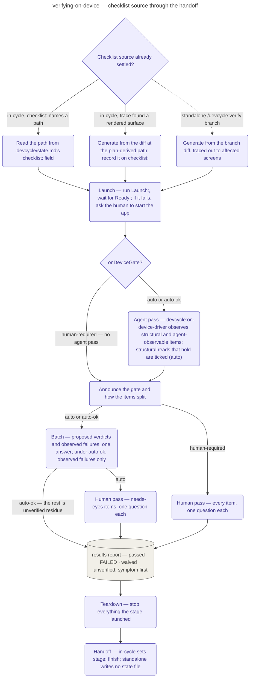

# Verifying On-Device

The pipeline's on-device verification stage, and the engine behind standalone
`/devcycle:verify <branch>`: rendered outcomes have no proving command, so this stage launches
the app, lets the browser driver settle what it can, and puts the rest to a human.

Which checklist source applies is settled before the walkthrough begins, and everything after
is identical either way. In-cycle, `executing-waves.md` generated the checklist during
execution and this stage reads its path from `.devcycle/state.md`'s `checklist:` field; when
execution wrote none but branch review's trace still found a rendered surface, this stage
generates one from the diff at the plan-derived path and records it there. Standalone
(`/devcycle:verify <branch>`), it derives one from the branch itself, automatically and without
a confirmation step. What counts as rendered, the trace outward from the changed files, and the
item shape — every item's `Tier:`, the `Launch:` and `Ready:` header lines — belong to
[`references/checklist.md`](../../../references/checklist.md). If the trace finds no rendered
surface, the stage writes no checklist and reports itself not applicable; in a cycle, branch
review has usually made that call already and skipped this stage.

The walkthrough runs in a fresh session carrying only the checklist path and the branch, in six
steps. **Launch:** the coordinator starts the app from the checklist's `Launch:` line through
`scripts/on-device-launch.mjs` and waits for `Ready:`; a launch that fails falls back to asking
you to start the app. **Agent pass:** it dispatches `devcycle:on-device-driver` over the
`structural` and `agent-observable` items, ticking `(auto)` each structural read that holds,
with its evidence path; the driver never decides a verdict. **Announce the gate:** one line says
which gate applies and how the items split. **Batch:** every `agent-observable` item and every
failure the agent observed comes to you as one question of proposed verdicts to confirm or
override (under `auto-ok`, the observed failures only). **Human pass:** each `needs-eyes` item
is asked on its own, telling you exactly where to look — bundling judgment measurably drops
findings quality. **Teardown:** everything the stage launched is stopped, whether it completes,
blocks or stops for your decision. The walkthrough ends with a results report, one line per
item, symptom first, each verdict one of `passed`, `FAILED` with a severity, `waived` with a
reason, or `unverified`.

The resolved `onDeviceGate` decides which steps run and when the stage closes. `auto`, the
default, runs the agent pass and asks you only the batch and the `needs-eyes` items.
`human-required` skips the agent pass and asks you every item, one by one; the driver may still
observe an item to help you. `auto-ok` lets the agent pass close the stage unless it observed a
failure, listing every item without an `(auto)` tick as unverified residue in the handoff — a
relaxed closing condition, never a relaxed reporting one. Without claude-in-chrome nothing is
ticked `(auto)` and every item is yours. The handoff then differs by path only in its state:
in-cycle, it sets `.devcycle/state.md`'s `stage: finish` field so the run resumes there;
standalone, it writes no state file at all, since an existing one belongs to someone else's
in-flight cycle.

## How it fits
- Up: [the pipeline](../../pipeline/README.md) — where on-device verification sits, between
  branch review and finish.
- Source: [`playbooks/verifying-on-device.md`](../../../playbooks/verifying-on-device.md) — the
  behavior spec this page summarizes.
- Standalone: [`commands/verify.md`](../../../commands/verify.md) — runs this stage directly,
  outside any cycle, from a branch's diff instead of a plan.

Playbook-internal — for where this sits in the pipeline, see
[docs/pipeline/](../../pipeline/README.md).
